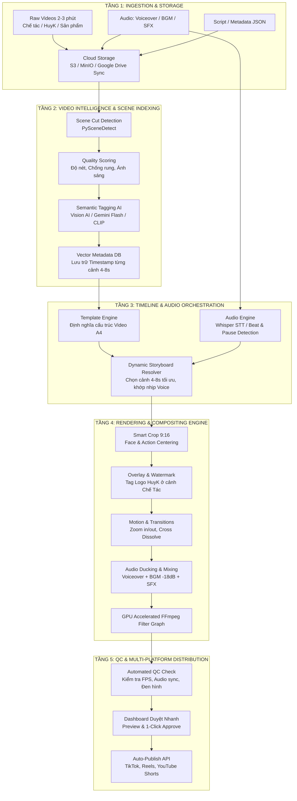

> ⚠️ **ĐÃ ĐƯỢC THAY THẾ** bởi bộ tài liệu [`docs/video-automation/`](./video-automation/README.md) (09/10/2026). Giữ lại để tham khảo lịch sử.

# KIẾN TRÚC HỆ THỐNG TỰ ĐỘNG HÓA SẢN XUẤT VIDEO HÀNG LOẠT
**Dự án**: Nền Tảng Render Video Tự Động Theo Kịch Bản Định Chuẩn (Automated Mass Video Generation Pipeline)  
**Khách hàng mục tiêu**: Viễn Chí Bảo - Trang Sức Phong Thủy & Kim Cương (Thương hiệu HuyK)  
**Định dạng chuẩn**: Video A4 (9:16 Dọc - TikTok, Facebook Reels, YouTube Shorts)

---

## 1. TỔNG QUAN VÀ PHÂN TÍCH ĐỀ BÀI

### 1.1. Hiện Trạng & Thách Thức Của Khách Hàng
- **Kho dữ liệu khổng lồ**: Khách hàng sở hữu hàng trăm GB dữ liệu video quay thô (raw footage) về xưởng kim hoàn, các thao tác chế tác tinh xảo (nung chảy, gõ búa cán phôi, cưa lọng hoa văn, đính kim cương/đá quý, mài bóng), các đoạn video tự quay hoặc sưu tầm, và video anh HuyK (KOL/Chuyên gia) chia sẻ.
- **Vấn đề của quy trình thủ công**:
  - Dựng thủ công tốn từ 2 - 4 tiếng cho 1 video ngắn 45s - 60s.
  - Video gốc thường dài từ 2 đến 5 phút, nhiều đoạn chết (thợ dừng tay, rung máy, out nét).
  - Không mở rộng được quy mô sản xuất để đăng tải 5 - 10 video/ngày trên đa nền tảng.
- **Mục tiêu**: Tự động hóa 100% việc chọn lọc các phân đoạn "vàng" (4s - 8s) từ các video dài (2 - 3 phút), khớp nhịp theo audio/kịch bản, đóng dấu bản quyền đúng cảnh, và ghép thành video hoàn chỉnh theo cấu trúc chuẩn.

### 1.2. Phân Tích Cấu Trúc Kịch Bản "Video A4"

Dựa trên sơ đồ timeline quy chuẩn của khách hàng:

```
[00:00 - 00:05] Khối 1: Sản Phẩm (Hook thu hút thị giác, zoom cận nhẫn/trang sức) -> 5 giây
       ↓
[00:05 - 00:09] Khối 2: HuyK (A-Roll: Chuyên gia giới thiệu vấn đề / đặt câu hỏi) -> 4 giây
       ↓
[00:09 - 00:14] Khối 3: Chế Tác 1 (B-Roll Nung/Đổ khuôn + Tag Logo HuyK) -> 5 giây
       ↓
[00:14 - 00:18] Khối 4: HuyK (A-Roll: Giải thích quy trình / kỹ thuật bí truyền) -> 4 giây
       ↓
[00:18 - 00:23] Khối 5: Chế Tác 2 (B-Roll Cưa lọng / Định hình + Tag Logo HuyK) -> 5 giây
       ↓
[00:23 - 00:27] Khối 6: HuyK (A-Roll: Nhấn mạnh sự tỉ mỉ / độ khó) -> 4 giây
       ↓
[00:27 - 00:32] Khối 7: Chế Tác 3 (B-Roll Đính hột kim cương + Tag Logo HuyK) -> 5 giây
       ↓
[00:32 - 00:40] Khối 8: Sản Phẩm Hoàn Thiện (Cận cảnh lung linh, mẫu đeo xoay 360) -> 5s - 10s (8s)
       ↓
[00:40 - 00:45] Khối 9: Outro HuyK (A-Roll kết thúc + CTA + Logo Viễn Chí Bảo) -> 5 giây
```

**Đặc điểm nhịp điệu (Rhythm & Pacing)**:
- Video có sự xen kẽ liên tục giữa **A-Roll (HuyK nói, tạo uy tín cá nhân - 4s)** và **B-Roll (Thao tác chế tác tay nghề cao - 5s)**.
- Thời lượng mỗi cảnh từ **4 đến 8 giây** là "điểm ngọt" (sweet spot) giữ chân người xem trên TikTok/Reels, loại bỏ hoàn toàn cảm giác nhàm chán.
- Yêu cầu đặc thù: **"Source gốc + Tag logo HuyK"**: Hệ thống phải tự động nhận diện phân cảnh nào là B-Roll chế tác để phủ watermark Logo HuyK / Viễn Chí Bảo lên góc video nhằm bảo vệ bản quyền.

---

## 2. KIẾN TRÚC TỔNG THỂ HỆ THỐNG (SYSTEM ARCHITECTURE)

Hệ thống được thiết kế theo mô hình **Event-driven Microservices / Pipeline Architecture**, gồm 5 phân tầng chính:



---

## 3. CHI TIẾT KỸ THUẬT TỪNG PHÂN TẦNG

### 3.1. Tầng 1: Ingestion & Smart Cataloging (Nạp & Phân loại dữ liệu)
- **Watcher & Ingestion Daemon**: Tự động đồng bộ từ Google Drive / NAS nội bộ của xưởng Viễn Chí Bảo khi thợ quay tải video lên.
- **Phân loại thư mục đầu vào**:
  - `01_HOOK_SAN_PHAM/`: Các video cận cảnh nhẫn, dây chuyền, đá quý thô.
  - `02_HUYK_A_ROLL/`: Video anh HuyK đứng trước ống kính nói chuyện, giải thích.
  - `03_CHE_TAC_B_ROLL/`: Video quy trình tay nghề (nung, gõ, cưa, đính đá, đánh bóng).
  - `04_SAN_PHAM_HOAN_THIEN/`: Video thành phẩm xoay 360 độ, đeo trên tay.
  - `05_OUTRO_CTA/`: Video kết thúc chuẩn của kênh.
  - `06_AUDIO/`: File Voiceover, BGM độc quyền, SFX xưởng kim hoàn.

### 3.2. Tầng 2: Video Intelligence & Scene Extraction (Thuật toán cắt 4-8s thông minh)
Video thô của khách hàng dài **2 đến 3 phút (120s - 180s)**. Để trích xuất cảnh chất lượng cao:
1. **Scene Cut Detection**: Sử dụng thuật toán dò chuyển cảnh (Content-aware & Threshold-based) chia video dài thành danh sách các sub-clips tự nhiên.
2. **Quality Scoring Filter (Bộ lọc chất lượng)**:
   - **Độ nét (Laplacian Blur Detection)**: Loại bỏ các frame bị mờ hoặc out nét do thợ di chuyển tay quá nhanh.
   - **Độ ổn định (Optical Flow / Camera Shake Estimation)**: Ưu tiên cảnh có chân máy hoặc góc máy chống rung tốt.
   - **Độ phơi sáng (Luminance check)**: Đảm bảo độ sáng đạt chuẩn, không bị cháy sáng lửa nung hoặc tối đen xưởng.
3. **Semantic Tagging (Gán nhãn ngữ nghĩa tự động)**:
   - Sử dụng AI Vision (Gemini 2.5 Flash / CLIP) phân tích keyframe để gán nhãn chi tiết:
     - `tag:nung_chay_lua`: Khò lửa nung kim loại trong chén.
     - `tag:can_keo_dap_bua`: Rèn tạo phôi nhẫn.
     - `tag:cua_long_khac`: Thợ tỉa hoa văn sắc sảo.
     - `tag:dinh_hot_kim_cuong`: Gắn chấu giữ đá quý, kính lúp soi vi mô.
     - `tag:danh_bong_sieu_am`: Máy quay bóng, tẩy rửa sáng loáng.
     - `tag:huyk_talking`: Anh HuyK nói chuyện, biểu cảm tự tin.
4. **Smart Clip Extractor (4s - 8s)**:
   - Mỗi subclip được chọn có độ dài chính xác theo slot template (Ví dụ: 4.0s hoặc 5.0s).
   - Hệ thống tự động chọn đoạn có biên độ chuyển động (motion score) sinh động nhất trong khoảng subclip đó, tránh lấy đoạn thợ đang dừng tay suy nghĩ.

### 3.3. Tầng 3: Audio Sync & Timeline Orchestration
- **Speech-to-Text & Word Timestamps (OpenAI Whisper / FastWhisper)**:
  - Phân tích file Voiceover của kịch bản để lấy chính xác thời điểm bắt đầu/kết thúc của từng câu nói và các khoảng lặng (pauses).
  - Tự động kéo giãn (stretch/compress) thời lượng của từng cảnh từ **4s đến 8s** để điểm chuyển cảnh (cut transition) rơi trúng điểm ngắt câu hoặc beat nhạc, tạo cảm giác mượt mà chuyên nghiệp.
- **Audio Ducking Algorithm**:
  - Nhạc nền (BGM) phát ở mức âm lượng nền (-22dB đến -26dB) khi có giọng nói Voiceover.
  - Khi ngắt câu hoặc chuyển sang cảnh hoàn thiện sản phẩm (Reveal), BGM tự động đẩy lên mức cao trào (-12dB đến -14dB).
  - Chèn hiệu ứng SFX (tiếng búa gõ kim hoàn `clink!`, tiếng khò lửa `whoosh`, tiếng lấp lánh `sparkle chimes`) chính xác tại frame chuyển cảnh.

### 3.4. Tầng 4: Compositing & Render Engine (FFmpeg GPU Filter Graph)
Hệ thống sử dụng FFmpeg cấu hình cao (hỗ trợ tăng tốc phần cứng Apple Silicon VideoToolbox hoặc NVIDIA NVENC):
- **Tỷ lệ hiển thị 9:16 (1080x1920)**: Tự động Smart Crop căn giữa chủ thể (thao tác tay thợ hoặc khuôn mặt HuyK).
- **Watermark Engine ("Source gốc + Tag logo HuyK")**:
  - Áp dụng bộ lọc `overlay` có điều kiện thời gian (`enable='between(t, start, end)'`).
  - Tự động phủ logo **"HUYK - VIENCHIBAO"** bán trong suốt (opacity 85%) kèm hiệu ứng viền phát sáng nhẹ ở góc trên giữa/trên phải màn hình tại đúng các phân đoạn B-Roll Chế tác.
- **Chuyển cảnh (Transitions)**: Áp dụng hiệu ứng `xfade` (fade/wipe/smooth move) thời lượng 0.3s giữa các cảnh mà không làm giật khung hình.
- **Color Grading Trang Sức (LUT / Color Balance)**: Tự động tăng độ tương phản nhẹ và độ bão hòa màu vàng/bạc để kim loại và giác cắt kim cương bắt sáng lấp lánh.

### 3.5. Tầng 5: Batch Processing & Auto-Publishing
- **Job Queue (Celery + Redis)**:
  - Cho phép nạp danh sách 50 kịch bản cùng lúc.
  - Phân tải render song song trên nhiều luồng CPU/GPU (tốc độ render đạt 1 video 45s chỉ trong 20 - 30 giây).
- **Quality Control (QC) tự động**:
  - Kiểm tra độ dài tổng thể video có lệch với audio quá 0.5s không.
  - Kiểm tra volume chuẩn EBU R128 (-14 LUFS cho TikTok/Reels).
  - Kiểm tra tỷ lệ khung hình và codec tương thích (H.264 / AAC).

---

## 4. BẢNG SO SÁNH GIẢI PHÁP KỸ THUẬT

| Thành phần | Lựa chọn Đề xuất | Lợi thế | Lựa chọn Thay thế |
| :--- | :--- | :--- | :--- |
| **Render Engine** | **FFmpeg Filter Complex (C++ / Python Wrapper)** | Hiệu năng cực cao, render trực tiếp không cần headless browser, ổn định tuyệt đối | Remotion (React), MoviePy |
| **Scene Splitting** | **PySceneDetect + Optical Flow** | Nhanh, chính xác đến từng mili-giây, phân tách cảnh quay mượt mà | OpenCV Frame Diff |
| **Semantic AI Tagging** | **Gemini 2.5 Flash / CLIP** | Nhận diện ngữ cảnh chế tác siêu nhanh, chi phí cực thấp (~$0.0001/video) | Tự train YOLOv8 custom |
| **Speech Alignment** | **Faster-Whisper (CTranslate2)** | Nhận diện tiếng Việt chuẩn xác, xuất word-level timestamp tốc độ x4 realtime | Whisper API |
| **Job Orchestration** | **Celery + Redis + FastAPI** | Chịu tải hàng ngàn job render, dễ mở rộng worker cluster | BullMQ / Node.js |

---

## 5. LỘ TRÌNH TRIỂN KHAI HỆ THỐNG (IMPLEMENTATION ROADMAP)

1. **Giai đoạn 1: Chuẩn hóa Input & Dựng Mock Pipeline (Đang thực hiện)**
   - Thống nhất tài liệu đặc tả Requirement với khách hàng Viễn Chí Bảo.
   - Xây dựng bộ dữ liệu mock-up 2-3 phút và script render thử nghiệm cấu trúc Video A4.
2. **Giai đoạn 2: Xây dựng Core Automation Engine**
   - Hoàn thiện module auto-crop 9:16 thông minh, auto-ducking audio và watermark overlay.
   - Tích hợp Whisper tự động cắt cảnh theo nhịp Voiceover.
3. **Giai đoạn 3: Tích hợp Gán nhãn AI & Dashboard Quản Trị**
   - Kết nối Gemini Flash phân loại tự động kho video hàng trăm GB của khách hàng.
   - Xây dựng giao diện Web UI (Next.js / FastAPI) cho phép nhân viên Viễn Chí Bảo chỉ cần paste kịch bản là bấm "Render Hàng Loạt".
4. **Giai đoạn 4: Đấu nối API Đăng tải Đa Nền Tảng**
   - Đặt lịch tự động đẩy video lên TikTok, Reels và Shorts kèm hashtag chuẩn SEO.
