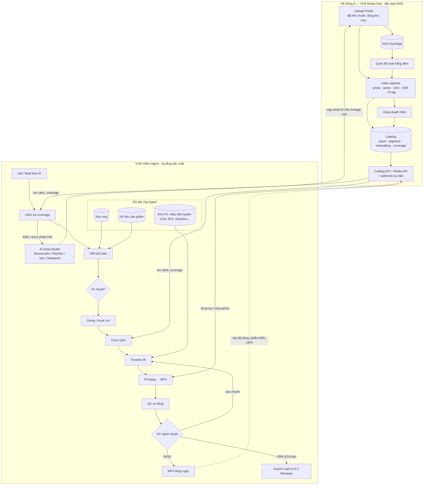

# 01 — Tổng quan & kiến trúc hệ thống agent sản xuất video human-in-the-loop

**Vai trò con người thay đổi:** từ *người dựng từng video* → *người duyệt & tinh chỉnh*. Agent làm 100% thao tác lặp (chọn clip, cắt, ghép, nhạc, SFX, chữ, transition). Người chỉ quyết định PASS / CẦN SỬA / LOẠI.

## 1. Mục tiêu

| Mục tiêu | Thước đo (nghiệm thu ở pilot) |
|---|---|
| Giảm công dựng | Giảm 80–90% phút công / video đạt chuẩn so với dựng tay (vd 60 → ≤9 phút gồm cả duyệt & sửa). |
| Chính xác | 0 lỗi sai SKU / sai claim / thiếu quyền lọt qua bản bàn giao. Timeline lệch ≤ 1 frame. |
| Chất lượng | Rubric biên tập ≥ 4/5 (đúng giọng HuyK, nhịp tốt, hình–lời khớp). |
| Dùng ngay | ≥ 70% video ở G2 được PASS không cần sửa (mục tiêu pilot, đo thực tế). |
| Có thể sửa tiếp | Video CẦN SỬA export được project CapCut nhiều track (video, VO, nhạc, SFX, chữ, transition) mở và sửa được. |
| Kho tự lớn | Footage mới đổ vào NAS được agent phân loại và sẵn sàng dùng trong ≤ 24h. |

**Ngoài phạm vi MVP:** auto-publish lên nền tảng; đa KOL (chỉ HuyK, kim hoàn); crawler tải nội dung bên thứ ba.

**Sinh asset bằng AI** (ElevenLabs, HeyGen, Veo, Seedance) là tầng *lấp chỗ trống* có guardrail, không thay footage thật. Xem [08](./08-ai-asset-studio-generate-bo-sung.md). Thứ tự bật: VO AI (Giai đoạn 2) → SFX/nhạc AI → image-to-video sản phẩm, b-roll Veo/Seedance, HeyGen (Giai đoạn 4, duyệt từng asset trong pilot, chỉ bỏ duyệt bắt buộc khi auto-score đã chứng minh đủ tin cậy).

## 2. Giả định đầu vào

1. **Thư viện footage gốc** trên NAS Synology (`/volume1/MEDIA VCB folder/...`), đã phân thư mục và **xếp đúng thứ tự** (công đoạn chế tác theo STT/tên hành động). Mỗi sản phẩm có **một bộ footage riêng**, không map chéo giữa các mã.
2. **Thư viện content viral**: kịch bản + video tham khảo + số liệu (view, nền tảng, quốc gia), được bổ sung định kỳ.
3. **Dữ liệu sản phẩm**: **chưa có**. Dùng mẫu dữ liệu đã thiết kế ở [02 §6](./02-thu-vien-footage-va-metadata.md) (Google Sheet / CSV, 1 dòng = 1 sản phẩm), agent soạn nháp từ kho, người duyệt.
4. **Kho nhạc bản quyền riêng của VCB** + SFX, transition, effect, text style, logo, outro, quy hoạch ở [07](./07-kho-am-thanh-hieu-ung.md).
5. **HuyK**: clip HuyK nói thật + voice clone (ElevenLabs) + avatar AI (HeyGen), coi như tài nguyên sẵn dùng (`voice_id`, `avatar_id` trong config).
6. **CapCut**: **CapCut Desktop Windows 9.3** (ví dụ chuẩn), **có tài khoản Pro**. Mac ngoài phạm vi MVP.
7. **Nhân sự**: đội **~100 người** chuyển sang vận hành hệ thống (duyệt, chiến lược nội dung, quay bổ sung, bản địa hóa, sửa CapCut). Phân bổ gợi ý ở [06 §1](./06-qc-van-hanh-lo-trinh.md).

## 3. Hai hệ thống tách biệt

**Quyết định (10/10/2026):** phần nạp footage vào NAS và index dữ liệu là **một hệ thống riêng: VCB Media Hub**. Hub đặt cạnh NAS và chịu toàn bộ phần IO nặng với kho. Hệ thống sản xuất video **không quét NAS, không đọc NAS trực tiếp**, chỉ gọi **Catalog API** và **Media API** của Hub.

| | **VCB Media Hub** (Hệ thống A) | **VCB Video Agent** (Hệ thống B, C, D) |
|---|---|---|
| Việc chính | Nạp footage mới vào NAS đúng quy chuẩn → index → duyệt nhãn → phát hành catalog | Brief → kịch bản → chọn cảnh → dựng → render → duyệt → export CapCut |
| Sở hữu dữ liệu | Asset, segment, nhãn, embedding, coverage, file NAS, proxy/mezzanine | Job, kịch bản, Timeline IR, render, quyết định duyệt, kho FX, kho viral, dữ liệu sản phẩm |
| Hạ tầng | Máy chủ on-prem **cạnh NAS** (LAN 10GbE), CPU nhiều nhân, GPU tùy chọn | Cloud hoặc on-prem tùy chọn; worker render co giãn; không cần đường truyền NAS |
| Đội phát triển | Có thể giao một nhóm riêng, làm song song | Nhóm chính |
| Giao tiếp | Phát sự kiện `asset.approved / updated / revoked`; cung cấp API | Chỉ đọc qua API; gửi lại `usage` (clip đã dùng) và `gap reports` (cảnh còn thiếu) |

Hệ quả: Media Hub vẫn chạy được khi hệ thống sản xuất dừng, và ngược lại. Đổi NAS, đổi cách lưu trữ hay mở rộng sang Đồ da/Đá quý chỉ đụng tới Hub.

## 4. Sơ đồ kiến trúc



## 5. Các module & trách nhiệm

**Hệ thống A — VCB Media Hub** (chi tiết: [03](./03-agent-phan-loai-footage.md))

| Module | Trách nhiệm | Deterministic hay AI |
|---|---|---|
| `upload-portal` | Nạp footage mới: gợi ý tên file theo quy chuẩn, đặt đúng thư mục sản phẩm, upload resumable | Code + UI |
| `nas-reconciler` | Quét đối soát hằng đêm: file đặt tay ngoài portal, file đổi tên/xóa | Code |
| `media-probe` | ffprobe, proxy 540×960 SDR, thumbnail, contact sheet, chuẩn hóa | Code (FFmpeg) |
| `filename-parser` | Parse quy chuẩn tên NAS → loại, KOC, SKU, sản phẩm, công đoạn, NV, STT | Code (regex + từ điển) |
| `shot-analyzer` | PySceneDetect, blur, phơi sáng, chuyển động, rung, khung đen | Code (OpenCV) |
| `asr` | Phiên âm clip có lời (HuyK nói) + word timestamps | Model ASR |
| `vision-tagger` / `reconciler` | Gắn nhãn theo taxonomy (model rẻ) / xử lý mâu thuẫn (model mạnh, ít gọi) | AI |
| `catalog-api` / `media-api` | Tìm segment, coverage, cấp proxy/mezzanine theo yêu cầu, phát sự kiện | Code |

**Hệ thống B/C/D — VCB Video Agent**

| Module | Trách nhiệm | Deterministic hay AI |
|---|---|---|
| `product-data` | Dữ liệu sản phẩm theo mẫu 02 §6: đồng bộ Sheet, kiểm tra, phiên bản | Code (+ agent soạn nháp) |
| `viral-analyzer` | Bóc cấu trúc kịch bản/video viral → pattern | AI + code |
| `script-writer` | Viết kịch bản theo template, facts, viral examples | AI |
| `voice` | TTS / chọn câu HuyK thật / avatar HuyK, đo duration, alignment, subtitle | Model + code |
| `clip-selector` | Lọc cứng + xếp hạng + chống lặp (gọi Catalog API) | Code |
| `timeline-planner` | Giải bài toán thời lượng → Timeline IR | Code |
| `ffmpeg-compiler` | IR → MP4 preview/final (media lấy từ Media API) | Code |
| `fx-library` | Kho nhạc bản quyền VCB, SFX, transition, effect, text style; ánh xạ FFmpeg ↔ CapCut | Code + AI gợi ý mood |
| `ai-asset-studio` | Sinh asset thiếu → nạp vào Hub như footage mới | AI + code |
| `capcut-adapter` | IR → project CapCut 9.3 Windows (chỉ khi người duyệt bấm Export) | Code |
| `qc` | Kiểm tra kỹ thuật, dữ liệu sản phẩm, trùng lặp | Code + AI flag |
| `work-distribution` | Chia việc duyệt cho ~100 người: hàng đợi, phân quyền, hiệu chuẩn | Code |
| `web-app` | Job board, bàn duyệt G1/G2, kho FX, cấu hình | UI |

## 6. Tech stack đề xuất

| Lớp | Lựa chọn | Ghi chú |
|---|---|---|
| API | Python 3.12 + FastAPI (cả 2 hệ thống) | Cùng ngôn ngữ với worker media/AI. |
| DB | PostgreSQL 16 + pgvector, **mỗi hệ thống một DB riêng** | Không truy cập chéo DB; chỉ qua API/sự kiện. |
| Queue / workflow | MVP: Celery (hoặc RQ/Arq) + Redis, state machine lưu ở Postgres. Mở rộng: Temporal | Đúng KISS. |
| Sự kiện giữa 2 hệ thống | Webhook có chữ ký HMAC (MVP) → message bus (NATS/Redis Streams) khi cần | Idempotent theo `event_id`. |
| Media | FFmpeg 7, ffprobe, PySceneDetect, OpenCV | Hub: cạnh NAS. Agent: worker render. |
| Storage | Hub: NAS (bản gốc) + cache proxy/mezzanine. Agent: object storage cho render và package | Agent không ghi vào NAS. |
| Web | Next.js + React | 2 app: Hub Portal, Agent Studio (đăng nhập chung SSO). |
| AI gateway | `model_gateway` gọi theo **vai trò**, dùng chung thư viện cho cả 2 hệ thống | Xem bảng dưới. |

### Model theo vai trò (đổi được qua config)

| Vai trò (`role`) | Mặc định đề xuất | Dự phòng | Lý do |
|---|---|---|---|
| `video_tagger` (bulk, Hub) | Gemini Flash (nhận video trực tiếp) | Claude Haiku 5.5 (`claude-haiku-5-5`) trên contact sheet 6–12 frame | Rẻ, chạy số lượng lớn. |
| `tag_reconciler` (Hub) | Claude Sonnet 5.5 (`claude-sonnet-5-5`) | GPT tương đương | Chỉ gọi khi mâu thuẫn / confidence thấp (~10–20% clip). |
| `script_writer` | Claude Sonnet 5.5 | GPT-5.4 Mini | Tiếng Việt tốt, structured output. |
| `hard_cases` / QC ngữ nghĩa | Claude Opus 5.5 (`claude-opus-5-5`) | — | Chỉ cho ca khó, mẫu kiểm chéo. |
| `asr` | ElevenLabs Scribe v2 | faster-whisper large-v3 (tự host cạnh NAS) | Word timestamps tiếng Việt. |
| `tts` | ElevenLabs Eleven v4 (giọng HuyK) | Flash v2.5 / MiniMax (đã dùng cho JP trong mẫu thật) | Chốt sau blind test. |
| `embedding` | text-embedding-3-small hoặc tương đương đa ngôn ngữ | — | Tìm segment bằng mô tả tự nhiên. |
| `sfx_gen` / `music_gen` | ElevenLabs Sound Effects / Music | — | Chỉ bổ sung khi kho nhạc bản quyền VCB thiếu mood. |
| `avatar_video` / `video_translate` | HeyGen (Digital Twin HuyK, Video Translate) | ElevenLabs Dubbing + lipsync | HuyK nói tại hình song song footage thật, mọi ngôn ngữ. |
| `video_gen` | Veo 3.x | Seedance 2.0 | B-roll trung tính, image-to-video sản phẩm từ ảnh thật. |

> Model ID, giá, khả năng tiếng Việt **phải benchmark lại** ở Giai đoạn 0. Lưu model + version + ngày test trong bảng `model_registry`.

## 7. Cấu trúc repo đề xuất (2 repo + 1 thư viện chung)

```
vcb-media-hub/                    # Hệ thống A — triển khai cạnh NAS
├── apps/portal/                  # Next.js: upload, duyệt nhãn, coverage
├── apps/api/                     # FastAPI: catalog-api, media-api, webhooks
├── workers/                      # reconciler, probe, parser, shot, asr, tagger
├── config/naming/                # nas_naming_rules.yaml, folder_map.yaml
├── config/taxonomy/              # roles.yaml, craft_steps.yaml (đồng bộ với agent qua API /taxonomy)
└── tests/fixtures/               # clip mẫu từ "Tài Nguyên VCB Real Sample"

vcb-video-agent/                  # Hệ thống B/C/D — hạ tầng sản xuất
├── apps/studio/                  # Next.js: job board, duyệt G1/G2, kho FX, cấu hình
├── apps/api/                     # FastAPI: jobs, review, artifacts, product-data
├── workers/produce/              # script, voice, selector, planner, compilers, qc
├── workers/gen/                  # AI Asset Studio
├── packages/timeline_ir/         # JSON Schema + validator + time math
├── packages/capcut_adapter/      # target profile capcut-win-9.3-pro
├── config/templates/             # A4_v1.yaml, A4_v2.yaml, A4_v3.yaml, A1_A3.yaml
├── config/style_presets/         # huyk_default.yaml
└── tests/golden/                 # golden IR, golden MP4, golden CapCut projects

vcb-shared/                       # thư viện chung: model_gateway, hub-client (SDK gọi Catalog API), schema sự kiện
```

## 8. Luồng dữ liệu & ranh giới

- File lớn nằm ở NAS (Hub quản lý); Agent chỉ nhận proxy/mezzanine qua Media API khi cần render, cache cục bộ theo sha256.
- LLM **chỉ nhận danh sách ứng viên rút gọn** (≤ 50 segment/slot dạng text), không bao giờ nhận toàn kho.
- LLM **không** ghi file draft CapCut, không chạy lệnh shell, không fetch URL tùy ý.
- Mọi bước lưu output bất biến + checksum đầu vào → sửa cục bộ chỉ chạy lại bước bị ảnh hưởng.
