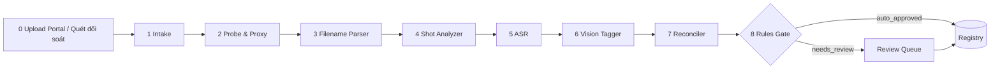

# 03 — VCB Media Hub: hệ thống riêng nạp footage vào NAS & index dữ liệu

> **Hệ thống độc lập** (chốt 10/10/2026). Hub đặt cạnh NAS, sở hữu toàn bộ việc nạp, lưu, index và phát hành footage. Hệ thống sản xuất video (VCB Video Agent) chỉ dùng Hub qua **Catalog API / Media API / sự kiện** (§8), không đụng NAS và không gánh hạ tầng index.

## 1. Mục tiêu

- **Nạp đúng ngay từ đầu:** footage mới vào NAS qua Upload Portal, tên file theo quy chuẩn và nằm đúng thư mục sản phẩm, không còn cảnh `IMG_9380.MOV` hay `0930(1).mp4`.
- **Index tự động:** mỗi file mới có metadata, segment, nhãn, điểm chất lượng và embedding, sẵn sàng phát hành cho bên sản xuất trong ≤ 24h (mục tiêu ≤ 2h với file nạp qua portal).
- Con người chỉ duyệt **ngoại lệ** (file sai quy chuẩn, nhãn mâu thuẫn), không gõ tag tay từng clip.
- Chi phí AI tối thiểu: **code làm trước, model rẻ làm số đông, model mạnh chỉ xử lý ca khó**.
- Phục vụ được nhiều bên tiêu thụ: Video Agent hôm nay; Đồ da, Đá quý, đội thiết kế sau này.

## 2. Upload Portal: nạp footage mới vào NAS

Luồng cho đội quay / thợ / editor:

```
Chọn file (kéo-thả từ thẻ nhớ, điện thoại, máy tính; upload resumable)
  → Form 20 giây: loại (CT/CTX/ST/KB/Daily/IT/OT/Live/Sưu tầm) · KOC · sản phẩm (chọn từ danh sách SKU) · công đoạn (chọn từ 13 bước) · mã NV
      (ngày quay lấy từ metadata file; STT tự tăng theo thư mục)
  → Portal sinh tên chuẩn: 260818_CT_HK_N0017_Nhan-mat-than-Horus-da-xanh_Gan-da-chu_DTA01_7.mp4
  → Kiểm tra: trùng sha256? quá dài (> 15s theo quy định V8 → cảnh báo, tùy chọn tự cắt theo shot)? xoay/HDR?
  → Ghi vào đúng thư mục: THƯƠNG HIỆU/1. KIM HOÀN/2. DỰ ÁN HUYK CHẾ TÁC SP/1. NHẪN/[N0017_Nhan-mat-than-Horus-da-xanh]/
  → Đẩy ngay vào hàng index (ưu tiên cao)
```

- **Bulk mode:** chọn cả thư mục thẻ nhớ → áp cùng loại/SKU/mã NV; công đoạn được AI gợi ý từ contact sheet, người sửa nhanh trên bảng.
- **Footage sưu tầm:** loại `Sưu tầm` + ô nguồn (link/nền tảng) → `rights_status = collected`.
- **Asset AI** từ AI Asset Studio và **kho nhạc bản quyền** của VCB cũng nạp qua cổng này (API), với `origin` tương ứng.
- Ghi NAS bằng tài khoản dịch vụ riêng của Hub (SMB hoặc Synology File Station API, do đội Hub chọn). Chỉ Hub có quyền ghi vào cây thư mục footage.
- File đặt tay vào NAS ngoài portal vẫn được **quét đối soát hằng đêm** (trạm 0). Nếu sai quy chuẩn, file vào hàng "đặt tên lại": portal đề xuất tên mới, người bấm duyệt, Hub đổi tên trên NAS và giữ lịch sử đường dẫn.

## 3. Luồng index (8 trạm)



| # | Trạm | Công cụ | AI? | Đầu ra |
|---|---|---|---|---|
| 0 | **Nguồn vào** | Upload Portal (chính, tức thì) + quét đối soát NAS hằng đêm (file đặt tay, đổi tên, xóa) | Không | Danh sách file mới/đổi/xóa |
| 1 | **Intake** | sha256 (đọc stream), pHash từ 3 frame | Không | `assets` row; trùng sha256 → chỉ thêm path; gần trùng pHash → cờ `near_duplicate` |
| 2 | **Probe & Proxy** | ffprobe; FFmpeg | Không | Thông số kỹ thuật; proxy 540×960 H.264 SDR 30fps; thumbnail; contact sheet 3×4 |
| 3 | **Filename Parser** | regex + từ điển (02 §2) | Không | `parsed`, `sku`, `source_type`, `craft_step`, `role_hint`, `parse_confidence` |
| 4 | **Shot Analyzer** | PySceneDetect (ContentDetector), OpenCV · clip > 30s: **nhánh clip dài** (§3.1) | Không | Danh sách segment + `quality` + `best_in/out` |
| 5 | **ASR** | Scribe v2 / faster-whisper — **chỉ khi** có giọng người (VAD) | Model ASR | `transcript`, `words` |
| 6 | **Vision Tagger** | Model rẻ (Gemini Flash video / Claude Haiku 5.5 trên contact sheet) | Có | Nhãn theo taxonomy (02 §3) + `description_vi` |
| 7 | **Reconciler** | Claude Sonnet 5.5 — **chỉ khi** mâu thuẫn hoặc conf < ngưỡng | Có (ít) | Nhãn chốt + lý do |
| 8 | **Rules Gate** | Code | Không | `approved` hoặc `needs_review` + lý do |

### Chi tiết từng trạm

**Trạm 2 — chuẩn hóa (bắt buộc theo dữ liệu thật):**
- Xoay: áp `rotation` tag (4 file iPhone xoay 270°) khi tạo proxy.
- HDR: `color_transfer = arib-std-b67` (HLG) hoặc `smpte2084` (PQ) → tone-map khi tạo proxy:
  `zscale=t=linear:npl=100,format=gbrpf32le,zscale=p=bt709,tonemap=hable:desat=0,zscale=t=bt709:m=bt709:r=tv,format=yuv420p`
- FPS: proxy về 30fps; giữ `fps_num/den` gốc để tính source in/out chính xác trên file gốc.
- Không chuyển đổi bản gốc. Bản "mezzanine" chất lượng cao chỉ tạo **khi segment được chọn vào video** (lazy).

**Trạm 4 — shot & chất lượng (trên proxy):**
- Cắt shot: `ContentDetector(threshold=27, min_scene_len=0.5s)`. File ≤ 15s thường chỉ 1–3 shot.
- Mỗi shot, lấy mẫu 4 fps:
  - `blur` = phương sai Laplacian (thấp = mờ) · `exposure` = % pixel cháy (>250) / bệt (<10)
  - `motion` = trung bình độ lớn optical flow (Farneback) · `shake` = phương sai vector chuyển động toàn cục
  - `black_frames` (ffmpeg `blackdetect`), `freeze` (`freezedetect`)
- `best_in/out`: cửa sổ 1.5–4s có `motion` trong ngưỡng "đang thao tác" và `blur` tốt nhất.
- `quality.score` ∈ [0,1] = trọng số chuẩn hóa (cấu hình được). Shot < 0.3 → `rejected` tự động (vẫn lưu, không dùng).

**Trạm 5 — ASR có điều kiện:** chạy `silero-vad`; nếu speech > 30% thời lượng → ASR. Bỏ qua clip chỉ có tiếng máy/búa (tiết kiệm phần lớn chi phí ASR). Keyterms: "HuyK", "Viễn Chí Bảo", "Moissanite", "S925", tên SKU.

**Trạm 6 — Vision Tagger (prompt rút gọn):**

```text
SYSTEM: Bạn là chuyên viên phân loại footage xưởng kim hoàn. Chỉ trả JSON đúng schema.
Chỉ dùng giá trị trong enum. Không suy đoán SKU. Không nhận diện danh tính người
ngoài việc trả lời huyk_present dựa trên ảnh tham chiếu HuyK được cung cấp.

USER:
- Ảnh tham chiếu HuyK: <3 ảnh>
- Contact sheet 12 frame (timestamp ghi trên frame) của shot <id>, thời lượng 6.2s
- Gợi ý từ tên file (có thể sai): type=CT, action_slug="Gan-da-chu", folder="DỰ ÁN HUYK CHẾ TÁC SP/NHẪN"
- Taxonomy: roles=[...], craft_steps=[...], shot_size=[...], ...
Trả về: roles[{role,conf}], craft_step{value,conf}, shot_size, camera, subject[],
huyk_present, mouth_visible_speaking, product_visible, metal, stone_color[],
lighting, text_or_watermark, motion_level, aesthetic, best_moment_s, description_vi (≤ 30 từ)
```

- Output validate bằng JSON Schema (Pydantic). Sai schema → retry 1 lần → vẫn sai thì `needs_review`.
- Batch: 1 request / shot; song song 20–50 worker; rate-limit theo provider.
- Cache theo `sha256 + shot range + prompt_version + model` → không tag lại khi chỉ đổi tên/di chuyển file.

**Trạm 7 — Reconciler, chỉ gọi khi:**
- `craft_step` từ tên file ≠ từ vision với cả hai conf > 0.6.
- `role` conf cao nhất < 0.6.
- `text_or_watermark = third_party` (logo Douyin/TikTok) → đánh dấu khoảng thời gian có watermark trên segment (`third_party_mark_ranges`). Asset vẫn dùng được, nhưng bộ chọn cảnh chỉ lấy đoạn sạch.
- `huyk_present` mâu thuẫn với `koc = HK` + `type = ST`.

Reconciler nhận: kết quả 2 nguồn + contact sheet + transcript; trả `final_labels` + `reason` + `needs_human: bool`.

**Trạm 8 — Rules Gate:**

| Điều kiện | Kết quả |
|---|---|
| `parse_confidence ≥ 0.8` AND không mâu thuẫn AND `quality.score ≥ 0.5` AND rights xác định từ folder nội bộ | `approved` (label_source = filename+ai) |
| Folder `Sưu tầm` | `rights_status=collected`; duyệt như footage thường theo chất lượng; chỉ dùng cho `hook_visual`, `stock_action`, `content_illustration` |
| Không xác định được nguồn (ngoài các folder đã biết) | `needs_review` + `rights_status=unknown` (pipeline không dùng) |
| `huyk_talk` (HuyK nói tại hình) | `needs_review` lần đầu để xác minh transcript (`verified_text`) |
| Còn lại | `needs_review` với lý do cụ thể |

Quyền mặc định theo folder: `CT/CTX/ST/KB/DAILY/OT/IT` của VCB → `owned`; `Sưu tầm` → `collected` (VCB chốt cho phép khai thác, 09/10/2026); `Tự quay` → `owned` sau khi người xác nhận người quay.

### 3.1 Nhánh clip dài (> 30 giây, ví dụ 4K 2–3 phút)

Quy chuẩn NAS là file ≤ 15s, nhưng file quay thô có thể dài 2–3 phút 4K. Ba khác biệt: giải mã 4K tốn máy; thường là **một cảnh quay liền** (bộ cắt cảnh không tìm được điểm cắt); phần lớn thời lượng là **cảnh chết** (tay ra khỏi khung, chờ, chỉnh máy) hoặc **động tác lặp**.

**Phân luồng:**

| File | Xử lý |
|---|---|
| ≤ 30s | Luồng chuẩn (trạm 2–8 như trên) |
| > 30s, không phải người nói tại hình | **Nhánh clip dài** (bên dưới) |
| > 30s, HuyK nói tại hình (`type=KB` hoặc VAD > 30%) | Cắt theo **ranh giới câu** từ ASR (không cắt theo chuyển động); MVP gắn cờ `needs_sentence_split` |

**5 bước (đã cài trong MVP: `mvp/indexer/long_clip_signals.py`, `long_clip_segmenter.py`):**

1. **Giải mã 4K đúng 1 lần** (giải mã phần cứng VideoToolbox/NVDEC). Một tiến trình FFmpeg ghi ra: master proxy (cạnh dài 1280, giữ tỉ lệ, SDR 30fps) + luồng phân tích 4 hình/giây cỡ 256×256 xám (đưa thẳng vào numpy, không ghi đĩa). Bản gốc không bị chuyển đổi.
2. **Tín hiệu từng khung (CPU, 0đ):** độ nét (phương sai Laplacian), độ sáng, % cháy/bệt, **chuyển động máy** (phase correlation; chỉ tính là máy chuyển động khi dịch toàn khung giải thích được thay đổi, nên bánh đánh bóng quay không bị nhầm là lia máy), **chuyển động chủ thể** (phần chênh lệch còn lại sau khi bù chuyển động máy), **tương quan bố cục** giữa 2 khung liên tiếp (lưới 32×32).
3. **Cắt 2 tầng:** cắt cứng khi tương quan < 0,3 (khung đen/bịt ống kính không tự gây cắt). Trong cảnh liền: bỏ khung **tối, cháy sáng, mờ, lia nhanh, đứng hình**, rồi chia đoạn còn lại thành **cửa sổ 4–8s**, đặt điểm cắt ở **nhịp nghỉ của động tác** (chuyển động thấp nhất), giữ được đoạn ≥ 1,5s. Mỗi cửa sổ có `best_moment` (khung nét nhất trong lúc đang thao tác).
4. **Lọc và giới hạn:** điểm Q_cpu < 0,3 → loại. **Gộp động tác lặp** bằng hash 256-bit của *ảnh trung bình* vùng giữa cửa sổ (≤ 50 bit khác = cùng "dáng"; giữ tối đa 2 đại diện mỗi dáng). Luôn giữ cửa sổ tốt nhất của mỗi cảnh cứng, rồi lấp theo điểm tới **ngân sách ~1 ứng viên / 10s nguồn**.
5. **Chỉ xuất phần được giữ:** cắt proxy 9:16 (720×1280) cho từng ứng viên từ master proxy. Nguồn quay ngang thì cắt khung dọc theo `crop_x`, tức tâm vùng có chuyển động. Tạo **contact sheet theo lô**: 12 ô = 6 ứng viên × 2 khung, có mã + mốc giây gốc, nên **1 lần gọi AI gắn nhãn 6 ứng viên**. Bản chất lượng cao 1080×1920 chỉ cắt từ file 4K gốc **khi ứng viên được chọn vào video** (mezzanine lười, `crop_x` áp lên 4K nên vẫn sắc nét).

**Vì sao lưu cửa sổ 4–8s chứ không cắt sẵn shot 2s:** mỗi vai trò cần độ dài khác nhau (chế tác 1,5–4s, nguồn 2–5s vì tăng tốc 1,25×; hook 1–2,5s; sản phẩm 3–5s). Bộ chọn cảnh lấy in/out chính xác quanh `best_moment` lúc dựng, nên một cửa sổ dùng được cho nhiều video với điểm cắt khác nhau.

**Đo thật (MVP, 11/10/2026):** clip test 2:50 4K HEVC 2160×3840, 40 Mbps, 841 MB, ghép từ 12 đoạn chế tác thật + 4 đoạn hỏng cài sẵn (bịt ống kính, mờ, lia nhanh, đứng hình) + 1 đoạn quay lặp lại.

| Chỉ số | Kết quả |
|---|---|
| Thời gian máy (Mac) | **~49s**: giải mã 1 lần 36s · phân tích 1,6s · cắt proxy + sheet 11s · RAM đỉnh 0,85 GB |
| Đầu ra | 26 cửa sổ → **17 ứng viên 4–8s** (5 vượt ngân sách, 4 trùng dáng) · proxy 53 MB so với gốc 841 MB |
| Loại đúng | tối 4,0s · mờ 7,5s · đứng hình 4,8s · lia nhanh 1,0s; đoạn hỏng lọt vào ứng viên: 0,5s / 103s |
| Độ phủ | **12/12** cảnh thật đều có ứng viên · **0** ứng viên lẫn 2 cảnh · đoạn quay lặp: 4 cửa sổ → giữ 2 |
| AI | **3 lần gọi** Haiku ≈ **$0,003** / clip 3 phút |

### 3.2 Logic chấm điểm cảnh: 3 tầng, rẻ trước đắt sau

| Tầng | Công cụ | Chạy trên | Ra | Chi phí / clip 3 phút |
|---|---|---|---|---|
| 1. Tín hiệu | CPU (numpy) | mọi khung | `q_cpu` + lý do loại | 0đ |
| 2. Mô tả hình | Claude Haiku trên batch sheet | ứng viên đã lọc | vai trò, công đoạn + `conf`, độ đẹp 1–5, mô tả | ≈ $0,003 (3 lần gọi) |
| 3. Quyết định xác suất | **Jev** (TypeSafe AI) | chữ: mô tả + nhãn + tín hiệu đã chia mức | `p_usable`, `p_role`, `p_step`, `premium`, `p_line` | ≈ $0,0003 |

**Tầng 1: `q_cpu`** = 0,35·độ nét (xếp hạng trong clip) + 0,20·phơi sáng + 0,30·"đang thao tác" (chuyển động chủ thể trong dải 0,6–2× mức điển hình của clip) + 0,15·độ ổn định máy.

**Tầng 2: test thật trên 17 ứng viên** (không gợi ý tên file, clip chứa 12 công đoạn khác nhau, tức ca khó nhất):

| Cấu hình sheet | Đúng công đoạn | Đúng ± 1 bước | Lần gọi / chi phí |
|---|---|---|---|
| 2 khung / ứng viên | 7/17 (41%) | 12/17 (71%) | 3 · $0,003 |
| 4 khung / ứng viên | 8/17 (47%) | 9/17 (53%) | 6 · $0,005 |

4 khung không tốt hơn rõ rệt (mẫu nhỏ, n = 17) mà gấp đôi chi phí, nên **giữ 2 khung làm mặc định**. Độ tự tin của model **tách được đúng và sai**: nhãn có `conf ≥ 0,55` đúng 5/7 (7/7 nếu chấp nhận lệch 1 bước), còn nhãn `conf < 0,55` chỉ đúng 2/10. Vì vậy không dùng nhãn như một quyết định có/không, mà **định tuyến theo xác suất**. Thực tế đa số file đặt tên theo công đoạn, nên nhãn kém tự tin rơi về tên file, hoặc vào hàng duyệt nếu file chứa nhiều công đoạn.

**Tầng 3: Jev, model trả lời bằng xác suất** (ra mắt 15/09/2026). Jev không sinh chữ. Mỗi request gửi một `state` và nhiều câu hỏi chạy song song, mỗi câu thuộc một trong ba loại: `noul` trả xác suất có/không, `choice` trả phân bố xác suất trên tối đa 255 lựa chọn, `score` trả thang 2–10 mức. Thông số do hãng công bố: $0,042 / 1 triệu token đầu vào, đầu ra miễn phí, 70–500 ms, ngữ cảnh 64k. **Jev chỉ đọc chữ, không nhận hình/video**, nên đứng sau tầng 2: Haiku "nhìn", Jev "quyết định". Bản "có vision" (Visual Jev, PixelJev) hiện chỉ là nghiên cứu/cộng đồng, chưa phải sản phẩm.

Hai thời điểm dùng Jev:

```json
// A. Lúc nạp: 1 request / ứng viên (hoặc gộp nhiều ứng viên vào state)
{"model": "jev-latest",
 "state": {"mo_ta": "Dùng nhíp đặt viên đá xanh lá vào ổ chủ trên nhẫn bạc, cận cực gần",
           "nhan_haiku": {"role": "craft", "craft_step": "gan_da_chu", "conf": "vừa", "aesthetic": "cao"},
           "tin_hieu": {"do_net": "cao", "chuyen_dong": "đang thao tác", "rung": "thấp"},
           "goi_y_ten_file": "Gan-da-chu"},
 "questions": {
   "usable":  {"type": "noul", "instructions": "Đoạn trong `state` có dùng được cho video quảng cáo trang sức cao cấp không?"},
   "role":    {"type": "choice", "instructions": "Vai trò của đoạn?", "criteria": {"craft": "...", "product_hero": "...", "huyk_talk": "...", "outro": "..."}},
   "step":    {"type": "choice", "instructions": "Công đoạn chế tác?", "criteria": {"gan_da_chu": "...", "dinh_da": "...", "none": "..."}},
   "premium": {"type": "score",  "instructions": "Mức sang trọng của hình?", "criteria": {"1": "kém", "3": "ổn", "5": "rất sang"}}}}

// B. Lúc dựng: 1 request / phần kịch bản, mỗi ứng viên là 1 câu hỏi noul chạy song song
{"state": {"cau_doc": "Khoan từng hốc đá nhỏ xíu, lệch một li là bỏ", "vai_tro": "craft", "ung_vien": {"c_12": "...", "c_31": "..."}},
 "questions": {"c_12": {"type": "noul", "instructions": "Ứng viên c_12 có minh họa đúng `cau_doc` không?"}, "c_31": {"type": "noul", "instructions": "..."}}}
```

**Định tuyến lúc nạp:** `p_usable ≥ 0,85` và `q_cpu ≥ 0,5` → `approved`; 0,4–0,85 hoặc `p_step` phân tán → hàng duyệt (hoặc Sonnet); < 0,4 → `rejected` (vẫn lưu). Luật cứng (SKU, quyền, sự thật sản phẩm) **vẫn bằng code**, không giao cho model.

**Điểm xếp hạng lúc dựng** (thay trọng số tay hiện tại ở `footage_matcher`):
`rank = 0,35·khớp công đoạn (luật) + 0,25·p_line + 0,20·q_cpu + 0,10·premium + 0,10·p_role` − phạt dùng lại theo kênh.

**Chi phí:** state ~300–500 token / ứng viên. Một clip 3 phút (17 ứng viên) tốn ≈ 8k token ≈ **$0,0003**. Một video 10 phần × 15 ứng viên ≈ 60k token ≈ **$0,0025**. Nhanh và rẻ hơn hẳn việc hỏi lại LLM cho từng ứng viên.

**Hiệu chuẩn:** lấy 200–300 ứng viên đã qua người duyệt (hàng duyệt §4 tự sinh ra) → chọn ngưỡng cho từng câu hỏi theo độ chính xác mục tiêu. Lưu mọi câu trả lời Jev cùng kết quả duyệt vào `cost_ledger` và `tag_corrections` để tinh chỉnh dần.

**Rủi ro và cách giảm:**
- Thông số Jev là **hãng tự công bố**, chưa có benchmark độc lập công khai. Nghiên cứu cho thấy lỗi của LLM judge **trùng phần lớn** với lỗi tự tin của Jev, nên Jev chủ yếu **tiết kiệm chi phí**, không tăng độ chính xác ([arXiv 2609.29769](https://arxiv.org/abs/2609.29769)). Pilot so với nhãn người trước khi bật.
- Jev kém với số và đếm, nên đưa tín hiệu **đã chia mức** (thấp/vừa/cao), không đưa số thô.
- Đăng ký mới đang tạm dừng (từ 22/09/2026); có thể truy cập qua Vercel AI Gateway (`typesafe-ai/jev`). Model đóng, chạy tại Mỹ.
- Dữ liệu gửi đi chỉ là **mô tả chữ**, không gửi hình hay video.
- Không có Jev thì giữ công thức hiện tại (trọng số tay + nhãn Haiku). Mọi model gọi qua model gateway nên đổi được.

**Đã cân nhắc và không chọn làm bộ chấm chính:**
- **V-JEPA 2 (Meta):** chỉ sinh embedding, không có nhãn chữ. Tín hiệu "bất ngờ" bám theo năng lượng chuyển động (trùng với tầng 1). Chỉ nên dùng sau này cho gộp trùng / đa dạng hoá.
- **"Jev có vision" theo phương pháp Visual Jev:** VLM nhỏ tự host (vd Qwen3-VL-2B qua vLLM) mã hoá ảnh **một lần**, chạy nhiều câu hỏi lựa chọn song song và đọc xác suất từ đầu ra model. Bài báo đo được nhanh hơn 8,9× khi hỏi 32 câu / ảnh. Cùng họ với VQAScore và G-Eval. Đây là **pilot giai đoạn 2** nếu muốn chấm xác suất trực tiếp trên hình. Cần GPU riêng, và phải hiệu chuẩn trên footage kim hoàn.

Nguồn: [Jev (Wikipedia)](https://en.wikipedia.org/wiki/Jev_(AI_model)) · [Jev API (flaviocopes.com)](https://flaviocopes.com/jev/) · [Visual Jev (arXiv 2609.25845)](https://arxiv.org/abs/2609.25845) · [V-JEPA 2](https://github.com/facebookresearch/vjepa2) · [VQAScore (arXiv 2404.01291)](https://arxiv.org/abs/2404.01291) · [G-Eval (arXiv 2303.16634)](https://arxiv.org/abs/2303.16634)

## 4. Hàng duyệt cho người (Review Queue UI)

- Mỗi thẻ: video proxy tự phát, contact sheet, nhãn đề xuất (màu theo conf), **lý do cần duyệt**, nút `Đúng hết` / sửa từng trường / `Loại`.
- Bulk: chọn nhiều shot cùng SKU/công đoạn → duyệt 1 lần. Phím tắt (J/K chuyển, A duyệt, R loại).
- Ưu tiên: segment thuộc SKU đang có job chờ > SKU trong kế hoạch tháng > backfill.
- Mục tiêu năng suất: ≥ 200 shot/giờ/người với duyệt bulk.
- **Mỗi lần sửa nhãn được lưu làm ví dụ** (`tag_corrections`) → nạp vào prompt few-shot của Vision Tagger theo `craft_step` → độ chính xác tăng dần.

## 5. Báo cáo coverage & phiếu bổ sung kho

Sau mỗi lần ingest, cập nhật ma trận **SKU × role × craft_step** (số segment approved).

```
SKU N0017 (Nhẫn mắt thần Horus đá xanh)   template A4 cần:
  product_hero ........ 4  ✔        huyk_silent ......... 1  ⚠ cần ≥ 3
  craft: nung_nau ..... 0  ✘        craft: gan_da_chu ... 6  ✔
  craft: dua_mai ...... 5  ✔        product_final ....... 0  ✘ → PHIẾU BỔ SUNG
  outro (chung) ....... 102 ✔
```

Phiếu bổ sung kho gửi đội quay: "N0017 thiếu: 3 shot sản phẩm hoàn thiện cận (macro, xoay), 2 shot HuyK quan sát/thao tác không nói".

## 6. Chiến lược quy mô & chi phí

- **Không backfill mù 38k file.** Thứ tự xử lý:
  1. Folder dùng chung mọi video: `SOURCE OUTRO` (102), `INTRO` (102), `DAILY HUYK` (1.153), `STOCK HÀNH ĐỘNG` (1.903).
  2. SKU trong kế hoạch content tháng (từ editor lead) → toàn bộ CT/CTX của SKU đó.
  3. **Index lười**: tạo job cho SKU chưa index → tự đẩy SKU đó lên đầu hàng ingest; job chờ trạng thái `MISSING_ASSET` đến khi xong.
  4. Backfill nền phần còn lại với **trần ngân sách/ngày**.
- File mới hằng ngày (từ đội quay) luôn được xử lý ngay.
- Ước lượng (phải đo lại ở pilot): trạm 0–4 chạy CPU nội bộ; AI chỉ ở trạm 5–7. Với contact sheet 12 frame, chi phí vision/shot ở mức rất nhỏ; trạm 7 chỉ ~10–20% shot. Ghi `cost_ledger` từng lần gọi để tính chi phí/shot thực tế.

## 7. Hạ tầng & vận hành worker (cạnh NAS)

Hub chạy trên **máy chủ on-prem cạnh NAS** (LAN 10GbE, CPU nhiều nhân, GPU tùy chọn cho ASR tự host / shot analyzer). Hạ tầng sản xuất video co giãn riêng, không chia tài nguyên với Hub.

| Hàng đợi | Loại worker | Song song | Ghi chú |
|---|---|---|---|
| `ingest.io` | Upload, intake, probe, proxy | theo số core CPU | Đọc/ghi NAS qua LAN; giới hạn băng thông giờ làm việc |
| `media.mezz` | Cắt mezzanine theo yêu cầu của Agent | 4–8 | Ưu tiên cao hơn backfill; cache theo sha256 + range |
| `ingest.cv` | Shot analyzer | CPU (GPU tùy chọn) | |
| `ingest.asr` | ASR | 4–8 | Có điều kiện VAD |
| `ingest.ai_cheap` | Vision tagger | 20–50 | Rate-limit, circuit breaker theo provider |
| `ingest.ai_strong` | Reconciler | 2–5 | Chỉ ca khó |

- Mỗi trạm **idempotent**: key = `sha256 + station + version`. Chạy lại không tốn thêm phí.
- Đổi `prompt_version` / `taxonomy_version` → chỉ tag lại khi editor lead bật "re-tag", có ước tính chi phí trước.
- File bị xóa/di chuyển trên NAS: giữ `asset` theo sha256, cập nhật path; nếu mất hẳn → `status = missing`, các job phụ thuộc bị cảnh báo.

## 8. Giao tiếp với hệ thống sản xuất (Catalog API · Media API · sự kiện)

| Endpoint / sự kiện | Dùng để |
|---|---|
| `GET /v1/segments/search` (`q`, `sku`, `roles[]`, `craft_step`, `min_quality`, `rights[]`, `exclude_used_by_channel`, `limit`) | Lọc cứng + tìm theo vector; chỉ trả segment `approved` |
| `GET /v1/coverage/{sku}?template=A4_v2` | Ma trận đủ/thiếu cảnh của một sản phẩm theo template |
| `GET /v1/products/{sku}/footage-set` | Toàn bộ segment thuộc bộ footage của sản phẩm, xếp theo công đoạn |
| `GET /v1/taxonomy` | Roles, 13 công đoạn, enum nhãn (có phiên bản) để 2 hệ thống dùng chung |
| `POST /v1/media/{segment_id}/mezzanine` → URL có hạn | Cắt sẵn đoạn src in/out ở chất lượng cao (1080×1920, SDR, 30fps) để render; cache theo sha256 + range |
| `GET /v1/media/{asset_id}/proxy` | Proxy xem nhanh cho bàn duyệt |
| `POST /v1/assets/ingest` | Nạp asset (AI Studio, kho nhạc) qua API, cùng luồng với portal |
| `POST /v1/usage` | Agent báo clip đã dùng (job, kênh, thị trường) → Hub tính `usage_count`, cooldown |
| `POST /v1/gap-reports` | Agent báo slot thiếu cảnh → Hub gộp thành phiếu bổ sung kho |
| Webhook `asset.approved` / `asset.updated` / `asset.revoked` | Agent cập nhật cache, vô hiệu job phụ thuộc asset bị thu hồi |

Nguyên tắc: API có version (`/v1`), xác thực bằng token dịch vụ, webhook ký HMAC và chống trùng theo `event_id`. Hub không biết gì về job, template hay kịch bản; Agent không biết gì về đường dẫn NAS.

## 9. Đánh giá chất lượng agent

- **Gold set**: 300 shot do editor gán tay (phủ đủ 13 công đoạn, HuyK nói/không nói, sản phẩm, outro, file sai quy chuẩn, footage sưu tầm có watermark).
- Chỉ số mỗi trường: precision/recall `role`, accuracy `craft_step`, F1 `huyk_present`, recall `third_party watermark` (**phải ≈ 100%**).
- Ngưỡng go-live: `role` top-1 ≥ 90%, `craft_step` ≥ 85%, tỷ lệ cần người duyệt ≤ 25%.
- Chạy lại gold set mỗi khi đổi model/prompt/taxonomy (regression).
